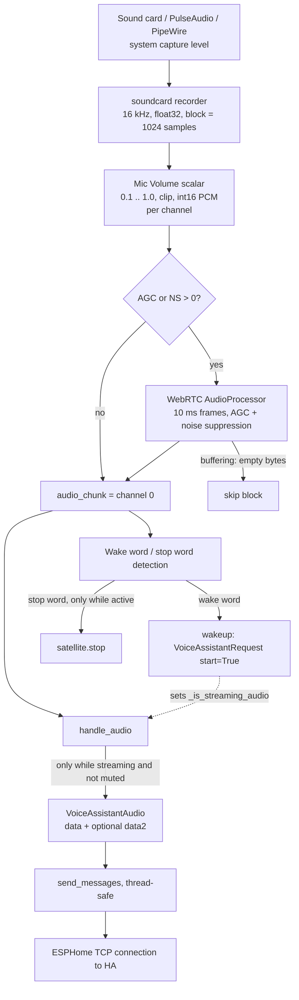

# Audio Input Pipeline

This document follows a microphone sample from the sound card to the Home Assistant (HA) connection. It describes what the code does today. The code is the source of truth: [`process_audio()`](../linux_voice_assistant/__main__.py), [`_float_to_pcm16()`](../linux_voice_assistant/__main__.py), [`webrtc.py`](../linux_voice_assistant/webrtc.py), `VoiceSatelliteProtocol.handle_audio()` and `wakeup()` in [`satellite.py`](../linux_voice_assistant/satellite.py), and `APIServer.send_messages()` in [`api_server.py`](../linux_voice_assistant/api_server.py).

## Overview



The same flow as plain text:

```
 Microphone / sound card
        |  (system capture level: PulseAudio / PipeWire / ALSA)
        v
 +--------------------------------------------+
 | soundcard recorder                         |
 | 16 kHz, float32, 1024 samples (64 ms)      |
 | shape (1024, N), N = 1 or 2 channels       |
 +--------------------------------------------+
        |
        v
 +--------------------------------------------+
 | _float_to_pcm16 (per channel)              |
 | x mic_vol_scalar (0.1 .. 1.0), clip, int16 |
 +--------------------------------------------+
        |  channel_chunks[0] = mic
        |  channel_chunks[1] = reference (if N = 2)
        v
   AGC > 0 or NS > 0 ?
     |no                        |yes
     |                          v
     |            +------------------------------+
     |            | WebRTCProcessor (ch 0 only)  |
     |            | 10 ms frames (320 bytes)     |
     |            | AGC + noise suppression      |
     |            +------------------------------+
     |                          |
     |                 empty (buffering)? --yes--> skip block
     |                          |no
     v                          v
 audio_chunk = channel 0 (processed if WebRTC active)
        |
        v
   state.satellite exists? --no--> skip block
        |yes
        +--------------------------+------------------------------+
        |                          |                              |
        v                          v                              v
 handle_audio()            wake word models              stop word model
        |                  (slot 0 / slot 1)             (only while active
        |                          |                      in active_wake_words)
 streaming and not muted?          | fired, not muted,            |
        |yes                       | refractory passed            v
        v                          v                       satellite.stop()
 VoiceAssistantAudio        satellite.wakeup()
 data  = audio_chunk               |
 data2 = unprocessed ch 0          v
         or channel 1       VoiceAssistantRequest(start=True)
         or none                   |
        |                          +--> _is_streaming_audio = True
        v
 send_messages()  (call_soon_threadsafe to the event loop)
        |
        v
 ESPHome TCP connection --> Home Assistant (STT)
```

Everything from capture to `send_messages()` runs on one thread, the audio thread started in `main()` (`process_audio`). Only the final write is handed over to the asyncio event loop.

## Stages

### 1. Capture

| Item | Value |
|------|-------|
| Library | `soundcard`, `mic.recorder(samplerate=16000, channels=N, blocksize=B)` |
| Device | `--audio-input-device` (name or index), otherwise the default microphone |
| Sample rate | fixed 16 kHz |
| Channels `N` | `--audio-input-channels` (1 or 2, default 2) |
| Block size `B` | `--audio-input-block-size` (default 1024 samples, 64 ms at 16 kHz) |
| Sample format | float32 in the range [-1, 1], shape `(B, N)` |

Channel 0 is the microphone. Channel 1, when present, is a reference signal (for example the speaker feed of a hardware echo canceller). The system capture level set in PulseAudio/PipeWire/ALSA is applied before LVA sees any sample. See [`enabling_aec.md`](enabling_aec.md) for system-level echo cancellation.

`record()` blocks until a full block is available, so the loop is paced by the sound card.

### 2. Software volume and PCM conversion

`mic_vol_scalar = max(0.1, min(1.0, state.mic_volume / 100.0))` is recalculated for every block. It can only attenuate, never amplify. Each channel goes through `_float_to_pcm16()`:

1. multiply by the scalar,
2. clip to [-1, 1],
3. scale by 32767,
4. convert to little-endian int16 bytes.

The result is `channel_chunks`, one `bytes` object per channel, each `B * 2` bytes (2048 bytes for the default block size).

`state.mic_volume` is the Home Assistant entity "Mic Volume" (1 to 100, `--mic-volume`, persisted in the preferences). Values from 1 to 10 all give the same 0.1 factor.

### 3. Optional WebRTC processing (channel 0 only)

`audio_chunk` starts as channel 0. `audio_chunk_unprocessed` keeps the same bytes before any WebRTC step.

If `preferences.mic_auto_gain > 0` or `preferences.mic_noise_suppression > 0`, the chunk goes through `WebRTCProcessor`:

- `mic_auto_gain` is the "Mic Gain" entity, values 0 to 31, passed as the AGC level. This is not the same as Mic Volume.
- `mic_noise_suppression` is the "Mic Noise Suppression" select, 0 (Off) to 4 (Max).
- The processor works on 10 ms frames (320 bytes). Input is buffered, whole frames are processed, and the result can be shorter than the input or empty (`b""`). On an empty result the loop skips the block (`continue`), including wake word detection.
- Because of the buffering, processed chunk sizes vary from block to block (for 2048-byte input: 1920 bytes now, the 128-byte remainder is carried over).
- Changing the settings in HA re-creates the `AudioProcessor` (`update_settings`).

`webrtc_active` records whether this step ran.

### 4. Gate: satellite must exist

If `state.satellite` is `None`, the block is dropped. This is the case before the first HA connection has created a `VoiceSatelliteProtocol`.

### 5. Wake word model refresh

If no models are loaded, or `state.wake_words_changed` is set, the loop rebuilds `wake_words` from `state.wake_words` filtered by `state.active_wake_words`. It also:

- picks the threshold per slot (preference override or the model's `probability_cutoff`),
- syncs the sensitivity entities and pushes their values to HA,
- creates `MicroWakeWordFeatures` and, if an openWakeWord model is active, `OpenWakeWordFeatures`.

### 6. Streaming to Home Assistant

`handle_audio(audio_chunk, audio_chunk_2)` is called for every block that reaches this point. Which second stream is attached:

| Situation | `audio_chunk` (`data`) | `audio_chunk_2` (`data2`) |
|-----------|------------------------|---------------------------|
| WebRTC active | processed channel 0 | unprocessed channel 0 |
| WebRTC off, 2 channels | channel 0 | channel 1 (reference) |
| WebRTC off, 1 channel | channel 0 | none |

`data2` is only sent if the installed `aioesphomeapi` knows the field (`_HAS_AUDIO_DATA2`). HA picks the stream it prefers for STT.

`handle_audio()` returns immediately unless `_is_streaming_audio` is true and the device is not muted. Otherwise it sends one `VoiceAssistantAudio` message through `send_messages()`.

`send_messages()` serializes the protobuf message, wraps it in the ESPHome plaintext frame and calls the transport's `writelines`. Because this runs on the audio thread, it schedules the write with `loop.call_soon_threadsafe()`.

Audio flows to HA only between a wake word (or a manual start) and the end of speech. `_is_streaming_audio` is set to true when `VoiceAssistantRequest(start=True, wake_word_phrase=...)` is sent. It is set to false by HA's `STT_VAD_END` / `STT_END` events (see "Voice pipeline state" in `CLAUDE.md`).

### 7. Wake word and stop word detection (same loop, same chunk)

After `handle_audio()`, the processed `audio_chunk` feeds the detectors:

1. `MicroWakeWordFeatures.process_streaming()` (and the openWakeWord equivalent) turns the PCM into feature windows.
2. Each active wake word model evaluates the windows against its threshold (slot 0 uses `wake_word_1_threshold`, slot 1 `wake_word_2_threshold`).
3. If a model fires, the device is not muted and the refractory time (`state.refractory_seconds`) has passed, `satellite.wakeup(wake_word)` runs.
4. The stop word model runs on every block to keep its state correct. It only acts if `state.stop_word.id` is in `state.active_wake_words` (during TTS, announcements and ringing timers) and the device is not muted. Then `satellite.stop()` is called.

`wakeup()` returns early when muted or when a pipeline is already active. Otherwise it ducks music, plays the wake sound and sends `VoiceAssistantRequest(start=True)`. With `listen_during_wake_sound` the request is sent right away; otherwise after the wake sound has finished. This is what turns streaming on in step 6.

The wake word runs on the same audio as the stream. Attenuation from Mic Volume and the WebRTC result therefore also change detection.

## `_float_to_pcm16`, AGC and `WebRTCProcessor`

These are three different stages of the same chain. `_float_to_pcm16` is not an AGC.

| | `_float_to_pcm16` | AGC | `WebRTCProcessor` |
|---|---|---|---|
| **What it is** | Helper function in `__main__.py` | One of two functions of the WebRTC audio processor | Class in `webrtc.py` wrapping the `AudioProcessor` from `webrtc_noise_gain` |
| **Purpose** | Convert format: float32 (-1 to 1) to int16 PCM bytes | Adjust the level automatically so quiet speech gets louder and loud speech quieter | Frame wrapper: buffers input, calls `Process10ms` per 10 ms frame, joins the results |
| **Level change** | Only through the scalar (0.1 to 1.0), so at most quieter, plus clipping | Dynamic, can amplify and attenuate | None itself, the effect comes from AGC and NS |
| **Setting** | Mic Volume (`mic_volume`) | Mic Gain (`mic_auto_gain`), 0 to 31, 0 = off | AGC level and NS level (`mic_noise_suppression`, 0 to 4) |
| **Runs** | Always, for every channel | Only if gain or NS is greater than 0 | Only if gain or NS is greater than 0, channel 0 only |

Order in the code:

1. `_float_to_pcm16` converts the samples and applies the fixed Mic Volume scalar.
2. If enabled, `WebRTCProcessor` processes the result. AGC (level) and noise suppression (noise) work inside it.

Mic Volume is a fixed control that only attenuates, the AGC keeps adjusting. Because the scalar is applied before WebRTC, the AGC already sees the attenuated signal. What the individual AGC levels do is defined in the `webrtc_noise_gain` library, not in LVA.

### Why `_float_to_pcm16` is needed although an AGC exists

The AGC does not replace it:

1. **Format conversion:** `soundcard` delivers float32 in the range -1 to 1. Everything downstream expects int16 PCM bytes: WebRTC (`Process10ms` takes bytes), the wake word models and `VoiceAssistantAudio` sent to Home Assistant. The AGC only receives its input from this function.
2. **The AGC is optional:** It only runs if gain or NS is greater than 0. With the default values (both 0) WebRTC is skipped entirely and `_float_to_pcm16` is the only stage.
3. **The AGC only handles channel 0:** Channel 1 (the reference) never goes through WebRTC but needs the same conversion.

The Mic Volume scalar only lives in the same function by convenience. The conversion would still be required with a scalar of 1.0. The scalar is merely a fixed, predictable control that can be set from Home Assistant. It only attenuates. For the basic input level, the system capture level (PulseAudio/PipeWire/ALSA) is usually the better place, because it acts before LVA reads the samples and can amplify.

## Timing summary

| Quantity | Value |
|----------|-------|
| Block duration (default) | 64 ms (1024 samples at 16 kHz) |
| Bytes per block and channel | 2048 |
| WebRTC frame | 10 ms, 320 bytes |
| Messages to HA | one `VoiceAssistantAudio` per block while streaming |

## Settings that affect this path

| Setting | Where | Effect |
|---------|-------|--------|
| `--audio-input-device`, `--audio-input-channels`, `--audio-input-block-size` | CLI / env | Capture parameters |
| Mic Volume (`--mic-volume`) | HA entity, preferences | Software attenuation, 0.1 to 1.0 |
| Mic Gain (`--mic-auto-gain`) | HA entity, preferences | WebRTC AGC level |
| Mic Noise Suppression (`--mic-noise-suppression`) | HA entity, preferences | WebRTC NS level |
| Mute switch | HA entity | Stops streaming and wake word activation |
| Wake word and stop word sensitivity | HA entities | Detection thresholds |

## Things to be aware of

- With WebRTC active, `data` and `data2` come from the same microphone block but can have different lengths, because only `data` goes through the 10 ms framing buffer.
- When WebRTC returns no data for a block, that block is skipped entirely, including wake word detection.
- The audio loop has no hardware-verified latency numbers in this document. They depend on the sound card, the audio server and the network.
