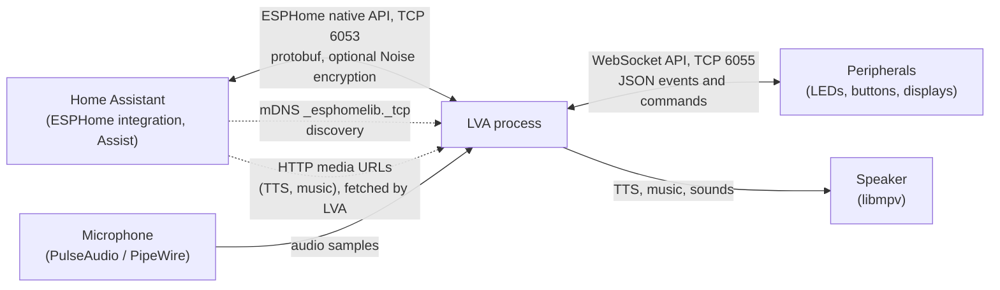
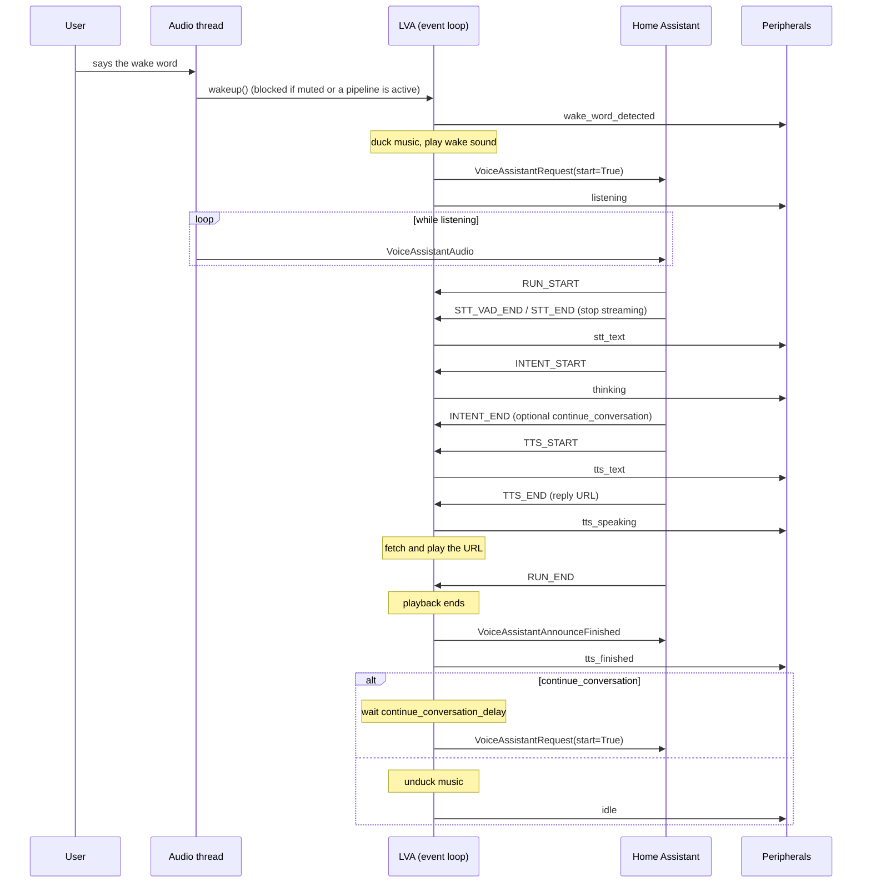

# Communication and Process Overview

This document explains who talks to whom in Linux Voice Assistant (LVA), over which interface, and in which order things happen during a voice request. It is the entry point; details live in the linked documents. The code is the source of truth: [`__main__.py`](../linux_voice_assistant/__main__.py), [`api_server.py`](../linux_voice_assistant/api_server.py), [`satellite.py`](../linux_voice_assistant/satellite.py), [`peripheral_api.py`](../linux_voice_assistant/peripheral_api.py) and [`zeroconf.py`](../linux_voice_assistant/zeroconf.py).

## Interfaces at a glance

LVA is one process. It offers two network interfaces and uses two audio paths.

| Interface | Direction | Purpose | Option | Details |
|-----------|-----------|---------|--------|---------|
| ESPHome native API (TCP `6053`) | Home Assistant ⇄ LVA | Voice pipeline, entities, timers, announcements, media player, wake word configuration | `--port` | below |
| mDNS (`_esphomelib._tcp`) | LVA → network | Lets Home Assistant discover the device | `--name`, `--network-interface` | below |
| Peripheral WebSocket API (TCP `6055`) | Peripheral ⇄ LVA | Visual state for LEDs/displays, button and volume input, extra entities | `--peripheral-host`, `--peripheral-port`, `--disable-peripheral-api` | [peripheral_api.md](peripheral_api.md) |
| Microphone capture | Sound server → LVA | Audio for wake word detection and speech to text | `--audio-input-device` | [audio_pipeline.md](audio_pipeline.md) |
| Media URLs over HTTP | Home Assistant server → LVA | TTS replies, music and announcement audio. LVA plays the URL, Home Assistant does not push audio data | | below |

## Home Assistant: the ESPHome native API

LVA pretends to be an ESPHome device. Home Assistant connects **to** LVA (LVA is the server), so the ESPHome integration must be able to reach the LVA host on the configured port.

### Discovery and connection

1. LVA registers the service `<name>._esphomelib._tcp.local.` over mDNS with its port and MAC address. If an encryption key is configured, the service also advertises `api_encryption`, so Home Assistant asks for the key when adding the device.
2. Home Assistant connects over TCP. [`APIServer`](../linux_voice_assistant/api_server.py) answers `HelloRequest`, `AuthenticationRequest`, `PingRequest` and `DisconnectRequest` on its own. Every other message goes to `VoiceSatelliteProtocol.handle_message()`.
3. Without an encryption key, frames are plaintext. With a key, the connection uses the ESPHome Noise handshake (`Noise_NNpsk0_25519_ChaChaPoly_SHA256`), and a client without or with a wrong key is rejected. See [API Encryption](install_application.md#feature-api-encryption).
4. Home Assistant asks for `DeviceInfoRequest`, `ListEntitiesRequest` and `SubscribeStatesRequest` / `SubscribeHomeAssistantStatesRequest`. Every entity answers for itself (see [configuration.md](configuration.md)), and the current states are replayed.
5. Home Assistant sends `VoiceAssistantConfigurationRequest` and LVA answers with the available and active wake words (at most 2 active). Home Assistant changes the selection with `VoiceAssistantSetConfiguration`. The result is stored in the preferences file.

Each Home Assistant connection gets its own protocol instance, but the settings, entities and players live in one shared state and survive reconnects. When the **last** connection closes, playback is stopped. See [behavior.md](behavior.md#connection-to-home-assistant).

### Messages LVA receives and sends

| Message | Direction | Meaning |
|---------|-----------|---------|
| `VoiceAssistantRequest(start=True, wake_word_phrase)` | LVA → HA | Start a pipeline run. The phrase is empty after a button press or a continued conversation |
| `VoiceAssistantAudio(data, data2)` | LVA → HA | One chunk of microphone audio. `data2` is the unprocessed channel when two channels are captured. See [audio_pipeline.md](audio_pipeline.md) |
| `VoiceAssistantEventResponse` | HA → LVA | Progress of the run: `RUN_START`, `STT_*`, `INTENT_*`, `TTS_*`, `RUN_END`, `ERROR` |
| `VoiceAssistantAnnounceRequest` | HA → LVA | Play an announcement, optionally with a pre-announce sound and a follow-up conversation |
| `VoiceAssistantAnnounceFinished` | LVA → HA | Playback of a reply or announcement has ended |
| `VoiceAssistantTimerEventResponse` | HA → LVA | Timer started, updated, cancelled or finished |
| `MediaPlayerCommandRequest` | HA → LVA | Play, pause, stop, volume, mute and URL for music or announcements |
| `Switch`/`Number`/`Select`/`LightCommandRequest` | HA → LVA | Changes of the device page entities |
| state responses | LVA → HA | New entity state, sent to all connected clients |

Audio is only sent while a pipeline run is listening and the device is not muted. Nothing is sent before the wake word.

## What happens during a voice request

Notes on the flow:

- **Who starts a run.** The wake word (audio thread), a button press (`start_listening` command from a peripheral), or a follow-up conversation after a reply. Home Assistant decides when speech ends (voice activity detection) and ends the streaming with `STT_VAD_END` or `STT_END`.
- **Early speech.** With `INTENT_PROGRESS` carrying `tts_start_streaming`, LVA starts playing the reply before `TTS_END`. Playback of the same reply is only started once.
- **No spoken reply.** If `RUN_END` arrives without any TTS playback, LVA finishes immediately and may play the pipeline ended sound.
- **Wake word protection.** While a pipeline run is active, including the TTS playback, wake words are ignored so the speaker output cannot trigger a new run.
- **Stop word.** The stop word is only active during TTS, announcements and a ringing timer, and stops playback locally without involving Home Assistant. See [behavior.md](behavior.md#the-stop-word).
- **Announcements and timers** do not start a pipeline run. Home Assistant pushes them with `VoiceAssistantAnnounceRequest` and `VoiceAssistantTimerEventResponse`, and LVA plays the sounds itself. See [behavior.md](behavior.md#announcements) and [behavior.md](behavior.md#timers).

## Peripherals: the WebSocket API

LVA is the WebSocket **server** on port `6055`, a peripheral connects as a client. Messages are JSON:

- **Events** (LVA → peripheral) report what the assistant does: `wake_word_detected`, `listening`, `thinking`, `tts_speaking`, `idle`, timer and volume events. The latest state event is replayed as a `snapshot` when a peripheral connects.
- **Commands** (peripheral → LVA) control it: `start_listening`, `stop_pipeline`, volume, mute, and `register_*` commands that add a light, button or button lock entity to Home Assistant.

Because registered entities are announced to Home Assistant over the ESPHome API, LVA waits `--peripheral-startup-wait` seconds at startup before it serves port `6053`. Peripherals that register later still work, but LVA then closes the Home Assistant connection once so Home Assistant re-reads the entity list.

The full protocol, all event and command names and examples are in [peripheral_api.md](peripheral_api.md).

## Startup order

1. Parse options, resolve network interface, name and MAC address, load the preferences file and the wake word models.
2. Create the shared state, then the peripheral API server (when not disabled).
3. Test-create the satellite protocol once, so initialization errors stop the start immediately, then bind the ESPHome server on `--port` (retrying up to 15 times if the address is in use).
4. Start the audio thread.
5. Register the mDNS service.
6. Start the peripheral API, send the `zeroconf` event (`getting_started`) and wait `--peripheral-startup-wait` seconds.
7. Start serving the ESPHome API.

## Threads

| Context | Runs |
|---------|------|
| asyncio event loop (main thread) | ESPHome server, peripheral WebSocket server, mDNS, handling of Home Assistant messages |
| audio thread | microphone capture, WebRTC processing, wake and stop word detection, sending audio chunks |
| libmpv threads | playback end callbacks, which continue the flow after a sound, reply or timer ends |

Messages from other threads are handed to the event loop, so the socket is only written from one place. Event handling for peripherals follows the same rule.

## Related documents

| Document | Contents |
|----------|----------|
| [audio_pipeline.md](audio_pipeline.md) | Microphone to Home Assistant, in detail |
| [behavior.md](behavior.md) | What the user experiences in each situation |
| [configuration.md](configuration.md) | Entities on the Home Assistant device page |
| [peripheral_api.md](peripheral_api.md) | WebSocket protocol for peripheral authors |
| [debugging.md](debugging.md) | Troubleshooting audio and container sockets |
