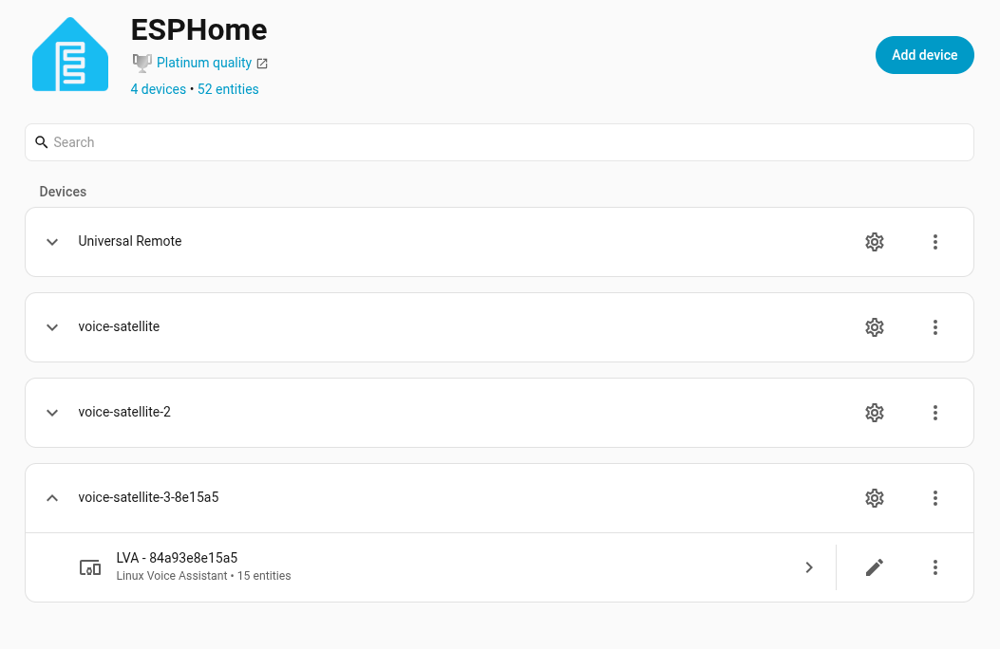
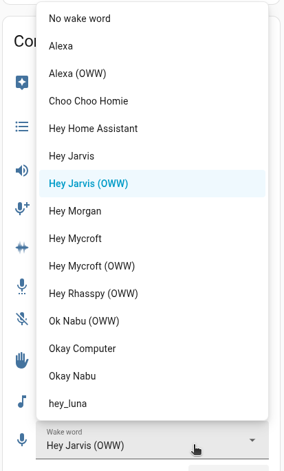
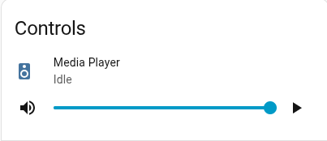
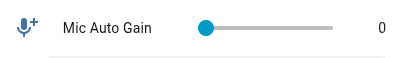
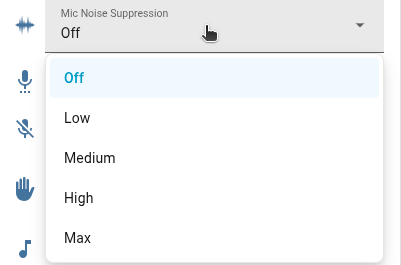
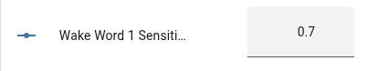
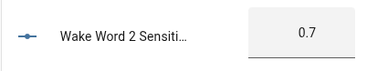

# Configuration

## Parameter overview

💡 **Note:** Every parameter has an environment variable for the Docker and systemd setup. Switches are enabled with `1` (for example `ENABLE_DEBUG="1"`). In the `.env` file of the Docker setup the variables are written as shown. In the systemd service file some variables need to be written without the `LVA_` prefix.

<details>
<summary><b>Usage (<code>--help</code>)</b></summary>

```sh
usage: __main__.py [-h] [--name NAME] [--audio-input-device AUDIO_INPUT_DEVICE] [--list-input-devices] [--audio-input-block-size AUDIO_INPUT_BLOCK_SIZE] [--audio-output-device AUDIO_OUTPUT_DEVICE] [--music-output-device MUSIC_OUTPUT_DEVICE] [--mpv-player-duck-mode {duck,pause}] [--enable-sendspin-bridge {0,1}] [--sendspin-control-dir SENDSPIN_CONTROL_DIR] [--sendspin-player-duck-mode {pulse,stop,duck}] [--list-output-devices] [--wake-word-root-dir WAKE_WORD_ROOT_DIR]  [--mic-auto-gain] [--mic-noise-suppression]
                   [--wake-model WAKE_MODEL] [--wake-model-2 WAKE_MODEL_2] [--stop-model STOP_MODEL] [--refractory-seconds REFRACTORY_SECONDS] [--wakeup-sound WAKEUP_SOUND] [--timer-finished-sound TIMER_FINISHED_SOUND] [--processing-sound PROCESSING_SOUND]
                   [--mute-sound MUTE_SOUND] [--unmute-sound UNMUTE_SOUND] [--preferences-file PREFERENCES_FILE] [--host HOST] [--network-interface NETWORK_INTERFACE] [--mac-address MAC_ADDRESS] [--port PORT] [--enable-encryption] [--encryption-key-file ENCRYPTION_KEY_FILE] [--enable-thinking-sound] [--enable-zeroconf {0,1}] [--listen-during-wake-sound] [--debug]
```

</details>

<details>
<summary><b>Home Assistant connection and identity</b></summary>

| Parameter | Environment variable | Description | Default |
| --- | --- | --- | --- |
| `--name` | `CLIENT_NAME` | Name of the voice assistant device (required) | Autogenerated (`lva-MAC-ADDRESS`) |
| `--preferences-file` | `PREFERENCES_FILE` | Path to a custom preferences JSON file | `preferences.json` |
| `--host` | `HOST` | API server IP-Address, can be 0.0.0.0 for all interfaces, but only one network card works for MAC-ADDRESS and ESP protocol | Autodetected |
| `--network-interface` | `NETWORK_INTERFACE` | Network interface for ESPHome server | Autodetected |
| `--mac-address` | `MAC_ADDRESS` | MAC address the device is known by in Home Assistant (colon separated, e.g. `02:00:00:00:00:01`). Keeps one identity across interfaces, or gives several instances on one machine each their own | The network interface's |
| `--port` | `PORT` | Port for ESPHome server | 6053 |
| `--enable-zeroconf` | `ENABLE_ZEROCONF` | Announce LVA via mDNS. `0` turns it off, Home Assistant then does not discover it automatically: add it manually with the host IP address and port `6053`. Does not change the ESPHome API or the peripheral API | 1 |
| `--enable-encryption` | `ENABLE_ENCRYPTION` | Encrypt the ESPHome API. LVA creates the key file if it does not exist (see [API Encryption](features.md#feature-api-encryption)) | False |
| `--encryption-key-file` | `ENCRYPTION_KEY_FILE` | Key file used when encryption is enabled (32 bytes, base64). LVA creates it with mode 600 if it does not exist | `encryption.key` next to the preferences file |

</details>

<details>
<summary><b>Audio input and output</b></summary>

| Parameter | Environment variable | Description | Default |
| --- | --- | --- | --- |
| `--audio-input-device` | `AUDIO_INPUT_DEVICE` | Soundcard name for input device | Autodetected |
| `--audio-input-block-size` | `AUDIO_INPUT_BLOCK_SIZE` | Audio input block size in samples | 1024 |
| `--audio-input-channels` | `AUDIO_INPUT_CHANNELS` | Number of audio input channels to capture (2 for devices with a hardware AEC reference channel). Does not change what is sent to Home Assistant | 1 |
| `--audio-output-device` | `AUDIO_OUTPUT_DEVICE` | Audio output device name, use a `pulse/...` name from the device list (`--list-output-devices`, `LIST_DEVICES`) | `pulse` |
| `--music-output-device` | `MUSIC_OUTPUT_DEVICE` | Music/media output device name (defaults to the voice output device) | `--audio-output-device` |
| `--mpv-player-duck-mode` | `MPV_PLAYER_DUCK_MODE` | What the music of LVA does while the assistant talks, an announcement plays or a timer rings: `duck` lowers the volume to 50 %, `pause` pauses the music and resumes it afterwards. Does not change the voice player | `duck` |
| `--enable-sendspin-bridge` | `ENABLE_SENDSPIN_BRIDGE` | `1` controls a Sendspin player (`sendspin-cli`, for example the Music Assistant Local Audio add-on) through its control socket: ducking, the state of the media player, play/pause/stop, volume and mute, see [behavior.md](behavior.md#sendspin-player). `0` turns it off, LVA then leaves the player alone | 1 |
| `--sendspin-control-dir` | `SENDSPIN_CONTROL_DIR` | Directory that holds `control.sock`, the control socket of the Sendspin player. Nothing is controlled through the socket while it does not exist. The socket has mode `0600`, so the player has to run as the user of LVA. In Docker the directory is mounted at the same path | `/run/sendspin-cli/socket` |
| `--sendspin-player-duck-mode` | `SENDSPIN_PLAYER_DUCK_MODE` | What happens to the Sendspin player while the assistant talks, an announcement plays or a timer rings: `pulse` lowers its sound stream in PulseAudio/PipeWire to 50 % (only while it plays; the Local Audio add-on passes the change on to its Sendspin group, so the other players are ducked too, needs the control socket to see that; without the sound server or a stream of the player nothing is ducked), `stop` stops it and starts it again afterwards, `duck` lowers the volume of the whole Sendspin group to 50 % | `pulse` |
| `--mic-volume` | `MIC_VOLUME` | Microphone volume 0 to 100, overrides the stored Mic Volume on every start. Leave it unset or empty to keep the stored value | stored value, else 100 |
| `--mic-auto-gain` | `MIC_AUTO_GAIN` | Add WebRTC Gain to Mic | 0 |
| `--mic-noise-suppression` | `MIC_NOISE_SUPPRESSION` | Add WebRTC Noise Suppression to Mic | 0 |
| `--output-only` | `ENABLE_OUTPUT_ONLY` | Enable output only mode | False |

</details>

<details>
<summary><b>Wake word, stop word and conversation</b></summary>

| Parameter | Environment variable | Description | Default |
| --- | --- | --- | --- |
| `--wake-word-root-dir` | `WAKE_WORD_ROOT_DIR` | Root directory of the wake word layout with `internal`, `downloaded` and `custom`, see [Wake Word](features.md#wake-word) | `wakewords/` |
| `--wake-model` | `WAKE_MODEL` | ID of active wake word model | `okay_nabu` |
| `--wake-model-2` | `WAKE_MODEL_2` | Wake word model for the second slot (empty = no second wake word). Used only when no wake words are stored yet, see [Custom Wake Word](features.md#custom-wake-word) | empty |
| `--stop-model` | `STOP_MODEL` | Stop model to use | `stop` |
| `--refractory-seconds` | `REFACTORY_SECONDS` | Seconds after an accepted wake word during which further detections of any wake word are blocked and discarded (logged at debug level). `0` turns it off. See [behavior](behavior.md#talking-to-the-assistant) | 0.0 |
| `--listen-during-wake-sound` | `LISTEN_DURING_WAKE_SOUND` | Start listening immediately after wake word detection, without waiting for the wake sound to finish | False |
| `--continue-conversation-delay` | `CONTINUE_CONVERSATION_DELAY` | Delay before mic opens for continued conversation | 0.5 |
| `--enable-thinking-sound` | `ENABLE_THINKING_SOUND` | Enable thinking sound on startup | False |
| `--timer-max-ring-seconds` | `TIMER_MAX_RING_SECONDS` | Seconds after which the timer stops ringing | 900.0 |

</details>

<details>
<summary><b>Sounds</b></summary>

| Parameter | Environment variable | Description | Default |
| --- | --- | --- | --- |
| `--wakeup-sound` | `WAKEUP_SOUND` | Sound file played when wake word is detected | `sounds/wake_word_triggered.flac` |
| `--start-listening-sound` | `START_LISTENING_SOUND` | Sound file played when button is pressed to start listening | `sounds/start_listening_button.flac` |
| `--timer-finished-sound` | `TIMER_FINISHED_SOUND` | Sound file played when timer finishes | `sounds/timer_finished.flac` |
| `--processing-sound` | `PROCESSING_SOUND` | Sound played while assistant is processing | `sounds/processing.wav` |
| `--mute-sound` | `MUTE_SOUND` | Sound played when muting the assistant | `sounds/mute_switch_on.flac` |
| `--unmute-sound` | `UNMUTE_SOUND` | Sound played when unmuting the assistant | `sounds/mute_switch_off.flac` |
| `--button-double-press-sound` | `BUTTON_DOUBLE_PRESS_SOUND` | Sound played on button double press | `sounds/button_double_press.flac` |
| `--button-triple-press-sound` | `BUTTON_TRIPLE_PRESS_SOUND` | Sound played on button triple press | `sounds/button_triple_press.flac` |
| `--button-long-press-sound` | `BUTTON_LONG_PRESS_SOUND` | Sound played on button long press | `sounds/button_long_press.flac` |
| `--pipeline-ended-sound` | `PIPELINE_ENDED_SOUND` | Sound file played when the voice pipeline ends without a response (e.g. no speech detected) | `sounds/pipeline_ended_low.flac` |

</details>

<details>
<summary><b>Peripherals</b></summary>

| Parameter | Environment variable | Description | Default |
| --- | --- | --- | --- |
| `--peripheral-host` | `PERIPHERAL_HOST` | Bind address for the peripheral WebSocket API | 0.0.0.0 |
| `--peripheral-port` | `PERIPHERAL_PORT` | Port for the peripheral WebSocket API | 6055 |
| `--peripheral-volume-step` | `PERIPHERAL_VOLUME_STEP` | Volume change per button press, 0.0–1.0 | 0.05 |
| `--peripheral-startup-wait` | `PERIPHERAL_STARTUP_WAIT` | Seconds to wait for peripherals to register entities before Home Assistant enumerates them (0 to skip) | 2.0 |
| `--enable-remote-unmute` | `ENABLE_REMOTE_UNMUTE` | `1`: Home Assistant can mute and unmute the microphone, like a peripheral. `0`: only a peripheral can unmute; Home Assistant has no Mute switch and only shows the mute state | 1 |
| `--disable-peripheral-api` | `DISABLE_PERIPHERAL_API` | Disable the peripheral WebSocket API entirely | False |

</details>

<details>
<summary><b>Debugging</b></summary>

| Parameter | Environment variable | Description | Default |
| --- | --- | --- | --- |
| `--debug` | `ENABLE_DEBUG` | Print DEBUG messages to console | False |
| `--colored-debug` | `ENABLE_COLORED_DEBUG` | Print colored DEBUG messages to console | False |

</details>

<details>
<summary><b>Docker and systemd only</b></summary>

These variables have no command line parameter.

| Environment variable | Description | Default |
| --- | --- | --- |
| `LIST_DEVICES` | Set to `1` to list the audio devices instead of starting (`--list-input-devices`, `--list-output-devices`) | not set |
| `LVA_USER_ID` | User ID for the container (usually 1000 for the first user) | `1000` |
| `LVA_USER_GROUP` | Group ID for the container (usually 1000 for the first user's group) | `1000` |
| `LVA_PULSE_SERVER` | Path to the PulseAudio/PipeWire socket (in some cases a `:unix` in front of the path is needed) | `/run/user/${LVA_USER_ID}/pulse/native` |
| `LVA_XDG_RUNTIME_DIR` | XDG runtime directory | `/run/user/${LVA_USER_ID}` |
| `LVA_PULSE_COOKIE` | Cookie file for PulseAudio if you use encryption. A temporary file is used by default to avoid errors if the file is not found | `/app/configuration/tmp_pulse_cookie` |

</details>

---

## Dashboard / HomeAssistant Entities

Once your satellite is connected, Home Assistant shows controls for it on the device page (ESPHome integration). With them you change LVA's behavior at runtime, without restarting the container or editing config files. Changes are saved in `preferences.json` and survive restarts.

<details>
<summary><b>Where to start</b></summary>

> **Go to [Settings > Devices & services](https://my.home-assistant.io/redirect/integrations/) and select the ESPHome integration.**



### Entities on the device page

Open an entity to see what it does and how to use it.

<details id="wake-word">
<summary><b>Wake Word</b> – Select: choose the active wake words</summary>

Matching parameters: `--wake-model`, `--wake-model-2`<br>
Matching environment variables: `WAKE_MODEL`, `WAKE_MODEL_2`

The device page shows one or two wake word selects (**Wake Word 1**, **Wake Word 2**), depending on whether your assistant is configured for dual wake words. A change takes effect immediately.



Each name in the dropdown shows where the wake word comes from (`Internal`, `Download` or `Custom`) and its engine, for example `Internal - OWW - Hey Jarvis`. **OWW** is [openWakeWord](https://github.com/dscripka/openWakeWord) and **MWW** is [microWakeWord](https://github.com/kahrendt/microWakeWord). You can mix both engines:

- **microWakeWord** models are lighter and run on lower-end devices. They are in the `wakewords/<origin>/microwakeword` directories.
- **openWakeWord** models are more accurate. They are in the `wakewords/<origin>/openwakeword` directories.

**No wake word.** If you set both selects to *No wake word*, no wake word starts the assistant, and a button cannot start listening either. After a restart LVA uses the default wake words again, because none are stored.

**After updating from an older version.** Home Assistant remembers the text of each select itself, and the names of the wake words changed (for example `Hey Jarvis` is now `Internal - MWW - Hey Jarvis`). LVA keeps your stored wake words, but a select with an old name shows *No wake word*, or one select shows a wake word and the other none, although LVA has both active. LVA cannot change what Home Assistant remembers. Choose the wake word again in each select. If a select keeps showing the old name, set it to *No wake word* once and then choose the wake word.

The [Wake Word section](features.md#wake-word) of the installation guide lists all bundled models and explains how to add custom ones.

</details>

<details id="mute-switch">
<summary><b>Mute Switch</b> – Switch: disable wake word detection and button listening</summary>

Matching parameters: `--enable-remote-unmute`<br>
Matching environment variables: `ENABLE_REMOTE_UNMUTE`

The **Mute** switch disables wake word detection and stops the assistant from reacting to any wake word or button, without stopping LVA. A sound confirms each change (`--mute-sound` / `--unmute-sound`).


With `--enable-remote-unmute 0` / `ENABLE_REMOTE_UNMUTE="0"` there is no **Mute** switch. Home Assistant then shows the mute state in a read-only **Mute** sensor, and only a peripheral can unmute. See [behavior.md](behavior.md#mute).

</details>

<details id="thinking-sound">
<summary><b>Thinking Sound</b> – Switch: play a chime while the request is processed</summary>

Matching parameters: `--enable-thinking-sound`<br>
Matching environment variables: `ENABLE_THINKING_SOUND`

The **Thinking Sound** switch turns on a short chime that plays while the assistant processes your request, between the end of listening and the start of the response. It is the same setting as `--enable-thinking-sound` / `ENABLE_THINKING_SOUND`, but you can change it at runtime.


</details>

<details id="media-player">
<summary><b>Media Player</b> – Media player: play media, control the volume of music and voice</summary>

The **Media Player** entity controls playback (play, pause, stop) and volume of:

- music and media played through the satellite, and
- the assist pipeline itself (wake word chime, TTS responses, thinking and processing sound).

Both share one volume. The slider changes both at once, and the value is restored on the next startup.



</details>

<details id="microphone-settings">
<summary><b>Microphone Settings</b> – Mic Volume (0–100), Mic Auto Gain (0–31) and Mic Noise Suppression (Off to Max)</summary>

Matching parameters: `--mic-volume`, `--mic-auto-gain`, `--mic-noise-suppression`<br>
Matching environment variables: `MIC_VOLUME`, `MIC_AUTO_GAIN`, `MIC_NOISE_SUPPRESSION`

**Mic Volume** sets the distance from which the microphone picks up your voice.


**Mic Auto Gain** (0–31, uses the [webrtc](https://github.com/OHF-Voice/webrtc-noise-gain) library) keeps the microphone level consistent: it boosts quiet speech and reduces loud speech. It helps with microphones that are too quiet, when you move around relative to the microphone, and to keep wake word detection consistent.

**Mic Noise Suppression** (Off, Low, Medium, High, Max in Home Assistant; `0`–`4` as parameter, same library) filters out constant background noise. It learns what silence sounds like in your room and subtracts it. It helps in noisy rooms, gives Home Assistant cleaner audio for speech to text and reduces false wake word triggers.




You can set gain and noise suppression in the Home Assistant entities above, or at startup with `--mic-auto-gain` / `--mic-noise-suppression` or `MIC_AUTO_GAIN` / `MIC_NOISE_SUPPRESSION` in the `.env` file. `0` turns the feature off.

💡 **Note:** A value set with a flag overwrites the stored value on every start, and a change in Home Assistant overwrites it until the next start. The `.env` file always overwrites the last value on startup.

</details>

<details id="wake-word-sensitivity">
<summary><b>Wake Word Sensitivity</b> – Numbers 0.0–1.0: probability cutoff per wake word and the stop word</summary>

Three number entities set the probability cutoff for the wake words and the stop word. Use them to match your microphone quality, room acoustics and tolerance for false activations.

| Entity | Description | Default |
|--------|-------------|---------|
| **Wake Word 1 Sensitivity**  | Cutoff for the primary wake word | From model manifest |
| **Wake Word 2 Sensitivity**  | Cutoff for the secondary wake word (if active) | From model manifest |
| **Stop Word Sensitivity**  | Cutoff for the stop word | From model manifest |

Values range from `0.0` to `1.0`:

- **Higher** (e.g. `0.95`): more selective, fewer false activations, may miss quiet or accented speech.
- **Lower** (e.g. `0.50`): more responsive, but triggers more often on similar-sounding words.

The defaults come from the `probability_cutoff` field in each model's `.json` manifest, for example `okay_nabu` (0.85) and `hey_jarvis` (0.97).

**Tuning:**

- If the wake word **rarely activates**, lower the value in steps of `0.05`.
- If it **activates too often** (TV, music, similar words), raise it slightly.
- A change of `0.05–0.10` is usually enough to notice a difference.
- Far-field microphones with noise cancellation (e.g. ReSpeaker, Satellite1) work well at the defaults. Basic USB microphones may need a lower value.

</details>

</details>

### Support

If a dashboard control does not behave as expected, enable `--debug` (or `ENABLE_DEBUG=1`) and check the logs. Every change made from the Home Assistant device page is logged when it is received and saved.
