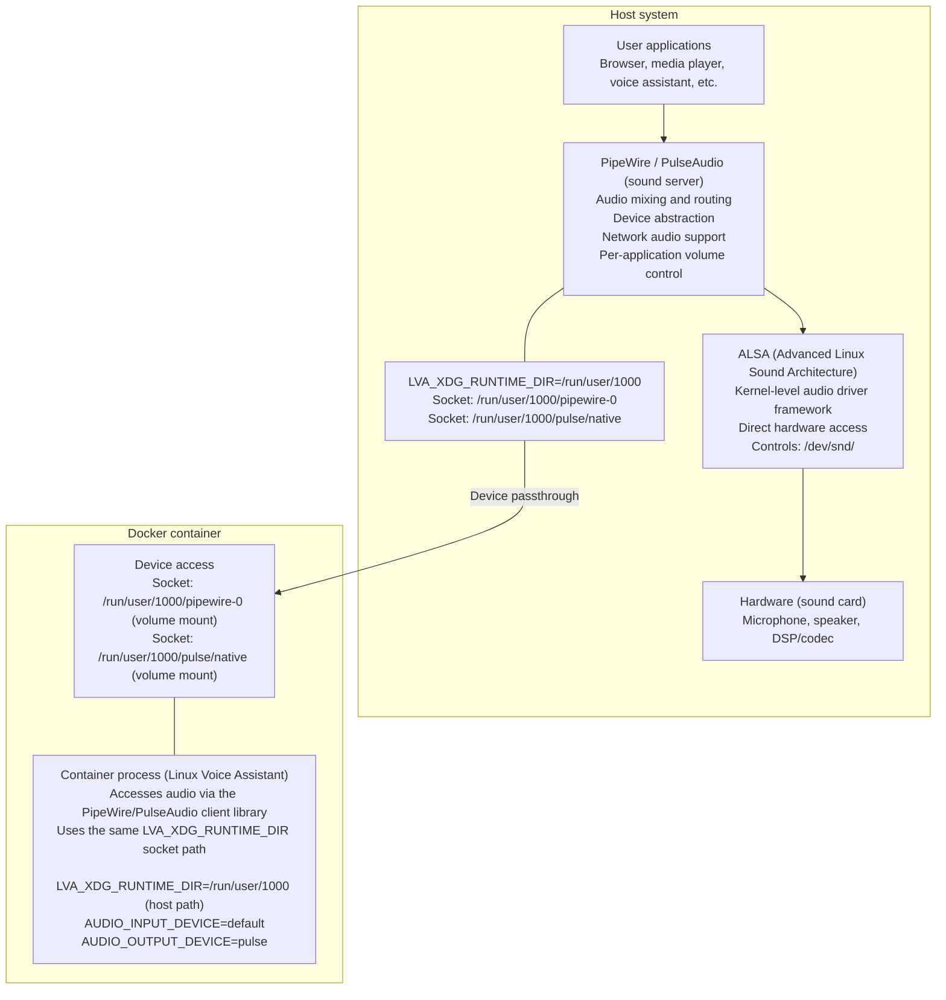

# Debugging

## Explanation of the audio system:

The Linux audio stack consists of multiple layers working together:



### How it works:

1. **Host Layer**:
   - ALSA provides kernel drivers for audio hardware
   - PipeWire/PulseAudio sits on top of ALSA as a sound server
   - Applications connect to PipeWire/PulseAudio, not directly to ALSA, otherwhise the container would need access to the ALSA devices. If you use ALSA only only one application can connect to the device at a time.

2. **Docker Integration**:
   - The LVA_XDG_RUNTIME_DIR socket must be mounted from host to container
   - The container user must have matching UID/GID with host user or the audio group is added.

3. **Communication Flow**:
   ```mermaid
   flowchart LR
       app["Container app"] --> client["PipeWire client library"]
       client -->|"via mounted socket"| server["Host PipeWire / PulseAudio"]
       server -->|"via ALSA drivers"| hw["Hardware<br>(audio data flows to the hardware)"]
   ```

4. **Key Configuration Points**:
   - `LVA_XDG_RUNTIME_DIR` must point to host's runtime directory
   - Container user UID/GID should match host user

### Docker Compose Example:

```yaml
services:
  voice-assistant:
    image: ghcr.io/ohf-voice/linux-voice-assistant:latest
    environment:
      - LVA_XDG_RUNTIME_DIR=/run/user/1000
      - AUDIO_INPUT_DEVICE=default
      - AUDIO_OUTPUT_DEVICE=pulse
    volumes:
      - /run/user/1000:/run/user/1000:rw
    devices:
      - /dev/snd:/dev/snd
    group_add:
      - audio
```


## List available audio devices:

To list available audio devices, run:

```bash
# List audio devices
docker run --rm -it -e LIST_DEVICES="1" ghcr.io/florian-asche/linux-voice-assistant:develop-final-docker-version
```

Update the `.env` file with your device names:

``` ini
AUDIO_INPUT_DEVICE="default"
AUDIO_OUTPUT_DEVICE="pulse"
```

The output list contains the same device several times, once per mpv audio driver (`pipewire/...`, `pulse/...`, `alsa/...`). Use the `pulse/...` entry, for example `AUDIO_OUTPUT_DEVICE="pulse/alsa_output.usb-Example.analog-stereo"`. `AUDIO_OUTPUT_DEVICE="pulse"` selects the default PulseAudio output without a device name.

To play music and media on a different device than voice and TTS, set `MUSIC_OUTPUT_DEVICE` to another entry from the same list. If it is unset, music uses `AUDIO_OUTPUT_DEVICE`.


## Pipewire runtime directory (Optional):

If you work with the root user, you need to:
``` sh
export LVA_XDG_RUNTIME_DIR=/run/user/${USERLVA_USER_ID
```

💡 **Note:** Replace `$USERLVA_USER_IDth your actual user id that you want to run the voice assistant.


## Troubleshooting:

### Audio Device Not Found:

If the container cannot access audio devices, ensure:

1. The USERLVA_USER_ID`.env` matches your actual users ID (run `id -u $USER` to check)
2. The LVA_XDG_RUNTIME_DIR path exists on the host

### Permission Denied Errors:

tbd

### "Incorrect preamble" in the log:

The ESPHome API port (`--port`, default 6053) only accepts ESPHome plaintext frames, which start with the byte `0x00`. If another client connects, LVA logs `Incorrect preamble: <byte>` and a hint:

| Byte | Meaning | What to check |
|------|---------|---------------|
| `1` | Client expects an encrypted connection | Start LVA with `--enable-encryption`, or remove the key from the client |
| `22` | TLS handshake | The ESPHome API port does not use TLS |
| `123` (`{`) | JSON | A peripheral client is connected to the wrong port: use `--peripheral-port` (default 6055) |
| `71` (`G`), `80` (`P`), `72` (`H`), ... | HTTP or WebSocket request | Same as above: peripherals use `--peripheral-port` (default 6055) |

### Low Audio Quality:

If you experience audio quality issues:

1. Check the audio device settings with `alsamixer`
2. Try setting `AUDIO_INPUT_DEVICE` and `AUDIO_OUTPUT_DEVICE` explicitly
3. Adjust the microphone gain in your system settings


## More debugging documentation:

See [PiCompose](https://github.com/florian-asche/PiCompose/blob/main/docs/pipewire_debugging.md) for more debugging information.
