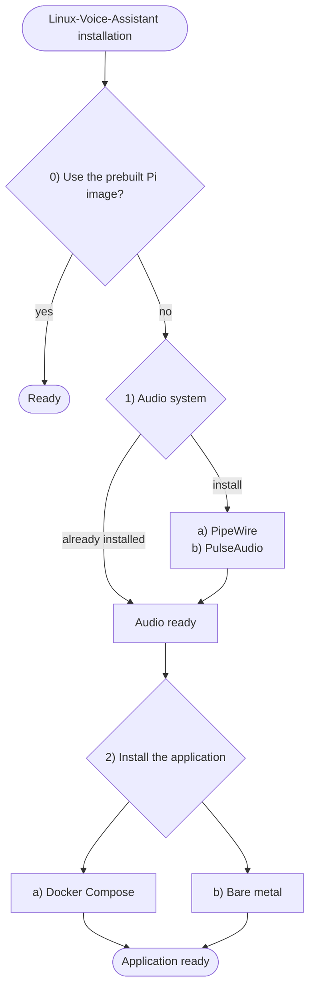

# Linux-Voice-Assistant - Installation

This guide describes how to install PipeWire, Docker, and then set up the Linux-Voice-Assistant using docker-compose manually. The Linux-Voice-Assistant is a voice assistant that runs locally and supports wake word detection, voice activity detection, and audio playback.

## Overview:

The installation process can be divided into the following steps:

## Installation (Docker-Compose or Systemd):

If you want to setup the software on your own hardware, for example if you want to use LVA on your linux desktop, you can use the docker image.

### Step 1: Install Audioservice:

LVA needs a sound server (PipeWire or PulseAudio) on the host. Choose one:

| Option | Use when | Guide |
| --- | --- | --- |
| **Existing PipeWire / PulseAudio** | One is already installed | Nothing to do |
| **PipeWire** (recommended) | No sound server yet | [Install PipeWire](installation_part1_audioserver.md#a-pipewire-recommended) |
| **PulseAudio** | You prefer it as an alternative | [Install PulseAudio](installation_part1_audioserver.md#b-pulseaudio) |

### Step 2: Install Application:

Run the application in one of two ways:

| Option | What you do | Guide |
| --- | --- | --- |
| **Docker Compose** (recommended) | Install Docker, download the compose files, configure and start | [Install with Docker Compose](installation_part2_application.md#a-docker-compose-recommended) |
| **Bare metal** | Install the dependencies, clone the repo, set up and create a systemd service | [Install on bare metal](installation_part2_application.md#b-bare-metal) |
