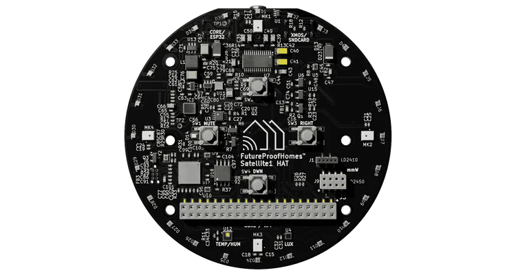

# Satellite 1 HAT Board



Peripheral controller for the [Satellite1 HAT Board](https://futureproofhomes.net/products/satellite1-top-microphone-board) by FutureProofHomes, running alongside the Linux Voice Assistant (LVA) container.

The controller runs as a separate Docker container on the same Raspberry Pi. It connects to LVA's peripheral WebSocket API, drives the 24-LED WS2812 ring with animations that mirror the [Home Assistant Voice PE](https://www.home-assistant.io/voice-pe/) LED behaviour, and maps the four hardware buttons to LVA commands with multipress support on the context action button.

> **Read the [Wiring](#wiring-and-pin-usage) section first.** The LED ring needs a jumper wire on the HAT when used with a Raspberry Pi, and the buttons are read over SPI from the HAT's XMOS chip — they are **not** connected to Raspberry Pi GPIO pins.

---

## Hardware

| Component        | Details                                                      |
| ---------------- | ------------------------------------------------------------ |
| Microphone array | XMOS XVF3800 (USB, far-field, onboard DSP)                   |
| LED ring         | 24 × WS2812 RGBW NeoPixels                                   |
| Buttons          | 4 × tactile (top, bottom, left, right), read from the XMOS chip over SPI |
| Audio output     | I2S line-out (optional)                                      |
| Interface        | Raspberry Pi 40-pin HAT connector                            |

### Compatible hardware

The controller was verified on:

- Raspberry Pi Zero 2 W with a Satellite1 HAT 1.1 (Trixie-based PiCompose image): LED ring and all four buttons working

Other Raspberry Pi models with a 40-pin header have **not** been tested with this version:

- Raspberry Pi 3 B / B+ and Raspberry Pi 4 B should behave like the Zero 2 W, but the DMA channel (see [Step 3](#step-3--check-the-dma-channel)) may need adjusting.
- Raspberry Pi 5: untested. The LED ring driver (`rpi_ws281x`) is not known to support the Pi 5, so the ring will probably not work.

Other revisions of the HAT have not been checked either.

---

## Wiring and pin usage

### LED ring: jumper required

The HAT routes the LED ring's data line to **header pin 15 (BCM GPIO 22)**. GPIO 22 has no PWM, PCM or SPI function, so `rpi_ws281x` cannot drive it. (The HAT was designed around an ESP32 core board, whose peripheral can drive any pin.)

Connect a jumper wire from **header pin 15 to header pin 32 (BCM GPIO 12, PWM0)**. The controller then drives the ring from GPIO 12 and leaves GPIO 22 as an input.

| Function                  | Header pin | BCM GPIO | Notes                                        |
| ------------------------- | ---------- | -------- | -------------------------------------------- |
| LED ring data (from HAT)  | 15         | 22       | Leave as an input; do not use for anything else |
| LED ring data (to driver) | 32         | 12       | PWM0, channel 0 — jumper to pin 15           |

Without the jumper the ring stays dark; only the HAT's power LEDs light. Software bit-banging GPIO 22 instead was tried and produced stray pixels, so the jumper is the recommended fix.

### Buttons: read over SPI

The four buttons are bits of the XMOS XVF3800's status register. The controller reads it over SPI (`/dev/spidev0.0`, mode 3) about 40 times per second by sending a NO-OP control frame; a change must be read twice in a row to count, which debounces the contacts.

| Bit | Button          | Behavior                    |
| --- | --------------- | --------------------------- |
| 0   | Right (Volume Up)   | Momentary, active low   |
| 1   | Bottom (Context action) | Momentary, active low |
| 2   | Left (Volume Down)  | Momentary, active low   |
| 3   | Top (Mute / Unmute) | Latching switch, 1 = muted |

Because the buttons are not on Raspberry Pi GPIOs, no GPIO library is needed and button pins cannot collide with kernel drivers.

### Pins to avoid

On the PiCompose image used for testing, other pins are already taken by the kernel; claiming them from software causes errors:

- GPIO 17 is the interrupt line of the USB-C power-delivery controller (`fusb302b` overlay).
- GPIO 18–21 are the I2S audio pins.

---

## Home Assistant Light Entity

The Satellite1 peripheral controller automatically registers an LED light entity with Home Assistant via LVA. This allows you to control the LED ring color and brightness directly from HA.

### Light entity details

| Property           | Value                                     |
| ------------------ | ----------------------------------------- |
| Entity ID          | `light.<satellite>_led_ring`              |
| Supported features | On/Off, RGB color, brightness, effect     |
| Default effect     | "Voice Assistant"                         |
| RGB default        | Cyan (9.4% R, 73.3% G, 94.9% B)           |
| Brightness default | 66%                                       |
| On/Off default     | **Off** (idle stays dark until activated) |

### Controlling from Home Assistant

In Home Assistant, you can:

1. **Turn the light on/off** — toggles the idle LED glow. When off, only active pipeline animations show (listening, thinking, speaking, etc.). When on, the ring displays your chosen color during idle/standby.

2. **Set color** — pick any RGB color. All pipeline animations are tinted by your chosen color (matching Home Assistant Voice PE behavior):

  - Wake word → Flash in your color
  - Listening → Chase in your color
  - Thinking → Pulse in your color
  - Speaking → Reverse spin in your color
  - Muted → Solid ring in your color + red at mic positions
  - Volume muted → Solid ring in your color + red at AUX jack corner LEDs
  - Timer → Countdown arc in your color

3. **Set brightness** — scales all animations by the chosen brightness (0–100%). Useful for adapting to ambient lighting.

4. **Use automations** — e.g., dim the LEDs at night, change color based on assistant state, or flash for alerts.

### Service calls example (YAML)

```yaml
# Turn on and set to purple
service: light.turn_on
target:
  entity_id: light.satellite1_led_ring
data:
  rgb_color: [200, 0, 255]
  brightness: 200

# Dim for night mode
service: light.turn_on
target:
  entity_id: light.satellite1_led_ring
data:
  brightness: 80

# Turn off (hides idle glow, shows only pipeline animations)
service: light.turn_off
target:
  entity_id: light.satellite1_led_ring
```

---

## Button behaviour

### Right button — Volume Up

Sends `volume_up` to LVA. A quick press increases volume by one step.

**Hold to adjust gradually:** keep the button held past 1000 ms and the controller keeps sending `volume_up` every ~150 ms — volume rises smoothly for as long as the button stays down, instead of one step per press. Release the button to stop.

### Left button — Volume Down

Sends `volume_down` to LVA. A quick press decreases volume by one step.

**Hold to adjust gradually:** the same behaviour applies in reverse — holding the button past 1000 ms repeats `volume_down` every ~150 ms until released.

### Top button — Mute / Unmute

The top button is a **latching switch** handled by the XMOS chip: it stays in the muted or unmuted position, and the chip mutes the microphone in hardware. The controller follows the switch: it sends `mute_mic` when the switch turns on and `unmute_mic` when it turns off, and the LED ring switches to the muted indicator pattern. If the satellite starts with the switch already on, `mute_mic` is sent once connected.

### Bottom button — Context action (with multipress and color change support)

This button supports single-press context actions, multi-press gestures, **and color changing via the HSV hue wheel** (matching Home Assistant Voice PE):

#### Single press

Context-aware command based on current assistant state, sent as soon as the button is pressed, mirroring the Home Assistant Voice PE centre button priority:

| Current state                                   | Command sent         |
| ----------------------------------------------- | -------------------- |
| Timer ringing                                   | `stop_timer_ringing` |
| Wake word / listening / thinking / TTS speaking | `stop_pipeline`      |
| Music / media playing                           | `stop_media_player`  |
| Any other (idle)                                | `start_listening`    |

**LED feedback while pressed:** whenever the button is physically held down — even for a very short tap — the LED ring lights up at the currently chosen color (or the default cyan if no color has been picked yet), then turns off again the instant the button is released. This only kicks in when the HA Light entity is currently **off**; if the light is already on, the idle animation is already showing the color, so nothing changes.

#### Multi-press gestures

| Gesture          | Timing                                      | Command sent          | Use case                                           |
| ---------------- | ------------------------------------------- | --------------------- | -------------------------------------------------- |
| **Double press** | 2 presses, releases < 250 ms apart          | `button_double_press` | Trigger custom HA automations, mode toggles, etc.  |
| **Triple press** | 3 presses, releases < 250 ms apart          | `button_triple_press` | Access menu, configuration, advanced features      |
| **Long press**   | Single press held for 1000 ms or more, sent on release | `button_long_press`   | Scene activation, do-not-disturb, night mode, etc. |

The context command is sent on the **first** press only; the extra presses of a double or triple press do not send it again. A gesture is recognised 250 ms after the last release, so double and triple press events arrive with a short delay.

**Examples:**

- Double press → start a specific routine or mode
- Triple press → access a menu or configuration option
- Long press → toggle do-not-disturb or night mode

These commands are exposed as button press events to Home Assistant (via the registered button sensor), allowing you to create custom automations via `button_press_event` triggers.

**Note:** The color change mode (hold + volume) activates after ~100 ms of holding, allowing quick single presses to still trigger context actions. Using the color wheel does not count as a gesture.

#### Hold + Volume buttons — Color wheel rotation

Hold down the action button and use the volume buttons to rotate through the HSV color wheel (matching Voice PE's rotary dial):

| Action                 | Effect                                                 |
| ---------------------- | ------------------------------------------------------ |
| **Hold + Volume Up**   | Rotate hue +10° (clockwise around color wheel)         |
| **Hold + Volume Down** | Rotate hue -10° (counter-clockwise around color wheel) |

**Hold the volume button to keep rotating:** a quick press of a volume button while holding the action button steps the hue by 10° once, same as above. If you keep the volume button held past 1000 ms, the controller keeps stepping the hue every ~150 ms — the color keeps rotating around the wheel for as long as you hold it, and stops the moment you release the volume button (the action button can stay held throughout).

**Real-time preview:** every hue step — whether from a single tap or the continuous hold-rotation — is applied to shared state immediately and shows up on the LED ring right away, without waiting on Home Assistant to echo the change back. This means the ring always reflects exactly the color you're about to select while you're still picking it.

The color wheel provides **36 distinct color stops** (0°–360° in 10° increments):

- **0°** – Red
- **60°** – Yellow
- **120°** – Green
- **180°** – Cyan
- **240°** – Blue
- **300°** – Magenta

Each press (or hold-repeat step) changes the hue by 10°, allowing smooth navigation around the full color spectrum. The LED ring updates immediately to show the new color during idle/standby (when the light is on).

**Example workflow:**

1. Press and hold the action button
2. Press and hold volume up to rotate continuously through warm colors (red → orange → yellow), or tap it repeatedly for single 10° steps
3. Release the volume button once you like the color, then release the action button to confirm and exit color mode
4. The new color persists in Home Assistant

#### Disabling button controls from Home Assistant

On connect, the controller registers a **Disable button controls** switch
with LVA, which appears on the device page as `switch.<satellite>_disable_button_controls` (off by default).

When turned **on** in Home Assistant, the action button (context command and gestures), volume buttons, and the hold + volume color-wheel gesture are all ignored — pressing them has no effect on LVA or the LED ring color. The mute switch is also ignored by the controller, but because it latches in the XMOS hardware it still mutes the microphone itself.

When turned **off**, button behavior resumes immediately.

The switch state is persisted by LVA across restarts, so a lock set from
Home Assistant survives a reboot of the satellite. On reconnect, the
controller reads the current state from the `snapshot` event's `button_controls_locked` field and applies it immediately, without
waiting for a change.

---

## LED ring animations

All animations mirror the Home Assistant Voice PE ESPHome firmware, scaled to the 24-LED ring. The ring color is driven by the HA Light entity (see [Home Assistant Light Entity](#home-assistant-light-entity) above).

| LVA state                      | Animation                          | Description                                                                                                                                                                                              |
| ------------------------------ | ---------------------------------- | -------------------------------------------------------------------------------------------------------------------------------------------------------------------------------------------------------- |
| No HA connection / error       | Red twinkle                        | Random red sparkle across all LEDs                                                                                                                                                                       |
| Idle                           | User color (when light on)         | Ring shows your HA light color at configured brightness, or off if light is disabled                                                                                                                     |
| Wake word detected             | Slow clockwise spin                | Two trailing arcs on opposite sides of the ring, tinted by your color                                                                                                                                    |
| Listening                      | Fast clockwise spin                | Same dual-arc pattern at 50 ms interval, tinted by your color                                                                                                                                            |
| Thinking                       | Pulsing pair                       | Two opposing LEDs fade in and out, tinted by your color                                                                                                                                                  |
| TTS speaking                   | Anticlockwise spin                 | Dual-arc spin in reverse direction, tinted by your color                                                                                                                                                 |
| Muted                          | Solid ring + red indicators        | Full ring tinted by your color; red at positions 0, 6, 12 & 18 (all 4 mic locations)                                                                                                                     |
| Error                          | Red pulse                          | All LEDs red, pulsing                                                                                                                                                                                    |
| Timer ticking                  | Countdown arc                      | Arc length proportional to `seconds_left / total_seconds`, tinted by your color                                                                                                                          |
| Timer ringing                  | Pulse + optional red               | Full ring pulsing in your color; red at 0, 6, 12 & 18 if muted                                                                                                                                           |
| Volume changed                 | Volume Display arc                 | Temporary arc (2.5s) showing the current volume level, starting from the AUX jack corner LED (D1, index 0) and sweeping clockwise across all 24 LEDs                                                     |
| Volume muted                   | Solid ring + red indicator         | Red at the AUX jack corner LEDs (positions 22, 23, 0, 1, 2) to indicate the media player volume is zero                                                                                                  |
| Action button held (light off) | Solid ring in chosen/default color | Overrides whatever else is showing for as long as the action button is physically held down, only while the HA Light entity is off — gives instant tactile feedback and previews color-wheel changes live |

**Note:** All animations except twinkle, off, and error animations use the color from the HA Light entity. This means you can customize the entire LED experience from Home Assistant by adjusting the light's RGB color and brightness.

---

## Installation

### Step 1 — Fit the LED jumper

Connect a jumper wire from **header pin 15 to header pin 32** on the HAT (see [Wiring and pin usage](#wiring-and-pin-usage)). Do this with the Pi powered off. Without it the LED ring will not light.

### Step 2 — Host kernel configuration
> **This must be done on the host Raspberry Pi, not inside Docker.**

Edit `/boot/firmware/config.txt` (or `/boot/config.txt` on older Raspberry Pi OS):

```
# Enable SPI — the HAT buttons are read from the XMOS chip over /dev/spidev0.0
dtparam=spi=on

# Enable PWM on GPIO 12 for the WS2812 LED ring
dtoverlay=pwm,pin=12,func=4

# Disable onboard audio — it shares PWM0 with GPIO 12
# dtparam=audio=on    ← comment this out

# Optional: I2S line-out if using the HAT's audio output
# dtoverlay=hifiberry-dac

# Optional: increase GPU memory on Pi Zero 2 W
# gpu_mem=64
```

Reboot after saving:

```
sudo reboot
```

After the reboot, check that the SPI device exists:

```
ls /dev/spidev0.0
```
> **Why disable onboard audio?** The Raspberry Pi's 3.5 mm headphone jack uses the same PWM0 hardware peripheral as GPIO 12. They cannot run simultaneously. The Satellite 1 HAT's XMOS microphone array connects over USB and is unaffected.
>
> The `pwm` overlay and the disabled onboard audio are part of the setup that was verified working. It has not been tested whether either one is strictly required.

### Step 3 — Check the DMA channel

`rpi_ws281x` needs a DMA channel that the kernel is not using. Its default, channel 10, is also used by the kernel on the Raspberry Pi Zero 2 W; the ring then updates a few frames and freezes once audio is playing. This example therefore uses **channel 14**, set with `--led-dma` in `compose.yml`.

To see which channels the kernel manages on your board:

```
od -An -tx1 /proc/device-tree/soc/dma-controller@7e007000/brcm,dma-channel-mask
```

On the Pi Zero 2 W this prints `0x7f35`: channel 10 is kernel-managed, and channel 14 (the highest managed channel, allocated last) works. If your board prints a different mask, pick a channel accordingly and change `--led-dma`.

### Step 4 — Groups (only when running Python directly)

The Docker container runs as root and needs no group setup. If you run the script directly on the host (Option B below), add your user to the `spi` group:

```
sudo usermod -aG spi $USER
```

Log out and back in for the group change to take effect.

### Step 5 — File structure

Place all files in the same directory:

```
Satellite1 HAT Board/
├── Dockerfile
├── compose.yml
├── requirements.txt
└── Satellite1_HAT_Board.py
```

### Step 6 — Build and start

#### Option A — Run with Docker Compose (recommended)

```
docker compose up -d
```

Check logs:

```
docker compose logs -f
```

You should see `LED ring initialised`, `Buttons configured (XMOS over SPI ...)` and `Connected to LVA peripheral API`.

#### Option B — Run directly with Python

```
pip install -r requirements.txt
python Satellite1_HAT_Board.py --host localhost --port 6055 --led-dma 14
```

---

## Configuration

All configuration is at the top of `Satellite1_HAT_Board.py`:

```python
# LVA connection
DEFAULT_LVA_HOST = "localhost"
DEFAULT_LVA_PORT = 6055

# LED ring data pin (BCM numbering) — jumpered from header pin 15, see "Wiring"
LED_GPIO_PIN = 12

# Buttons are read from the XMOS chip over SPI, not from Pi GPIOs
SPI_BUS      = 0
SPI_DEVICE   = 0
SPI_MODE     = 3
SPI_SPEED_HZ = 500_000   # The XMOS supports up to 1 MHz

# Bit numbers in the XMOS gpio_port_a byte
BTN_BIT_VOLUME_UP   = 0   # Right button
BTN_BIT_ACTION      = 1   # Bottom button
BTN_BIT_VOLUME_DOWN = 2   # Left button
BTN_BIT_MUTE        = 3   # Top button (latching)

BTN_POLL_INTERVAL_S = 0.025   # ~40 Hz; a change must be read twice to count

# Volume button hold-to-repeat (also drives continuous color wheel rotation
# while the action button is held — see "Hold + Volume buttons" above)
VOLUME_HOLD_THRESHOLD_MS = 1000  # Hold time before gradual repeat kicks in
VOLUME_HOLD_REPEAT_S     = 0.15  # Seconds between repeated steps while held

# Action button gestures
MULTIPRESS_WINDOW_MS = 250    # Max time between releases of a multi-press
LONG_PRESS_MS        = 1000   # Hold time that counts as a long press
ACTION_HOLD_MS       = 100    # Hold time that enters color change mode

# LED ring
LED_COUNT      = 24
LED_DMA        = 14     # Overridden by --led-dma
LED_BRIGHTNESS = 168    # 0–255, default is 66 % (168)

# HA Light entity registration
LIGHT_OBJECT_ID = "led_ring"
LIGHT_NAME      = "LED Ring"
EFFECT_VOICE_ASSISTANT = "Voice Assistant"

# Default ring colour — matches HA Voice PE default (cyan)
# These are used before the first light_command from HA arrives
DEFAULT_R, DEFAULT_G, DEFAULT_B = 24, 187, 242
```

### Light entity configuration

The light entity is automatically registered with LVA on startup and will appear in Home Assistant as `light.<satellite>_led_ring`. You can customize it in HA's UI:

- **Entity name** — rename to your preference in HA
- **Color** — adjust in HA's light picker (RGB mode)
- **Brightness** — scale all animations
- **Toggle on/off** — show/hide idle glow
- **Automations** — react to time of day, other entities, etc.

For details, see [Home Assistant Light Entity](#home-assistant-light-entity) above.

### Command-line arguments

The container command in `compose.yml` accepts:

| Argument    | Default     | Description                                                       |
| ----------- | ----------- | ----------------------------------------------------------------- |
| `--host`    | `localhost` | LVA container hostname or IP                                      |
| `--port`    | `6055`      | LVA peripheral API port                                           |
| `--led-dma` | `14`        | DMA channel for the LED ring; must not be one the kernel uses     |
| `--debug`   | off         | Enable verbose debug logging                                      |

To connect to LVA running on a different host:

```yaml
command:
  - "--host"
  - "192.168.1.50" # Use your actual device ip address
  - "--port"
  - "6055"
  - "--led-dma"
  - "14"
```

---

## Connection to LVA

The controller connects to LVA's peripheral WebSocket API at `ws://<host>:6055`. The LVA container must have the peripheral API enabled (it is on by default) and port 6055 must be reachable.

On startup the controller:

1. Connects to LVA and registers a Light entity for the LED ring with Home Assistant
2. Receives a state snapshot (current mute state, volume, HA connection status, and light state)
3. Sets the LED ring to the appropriate animation immediately
4. Begins listening for events from LVA and button presses from the hardware

If the connection is lost (LVA restarted, network drop), the controller shows a red twinkle animation and automatically reconnects every 3 seconds.

---

## Using multipress events in Home Assistant

The multipress commands (`button_double_press`, `button_triple_press`, `button_long_press`) are sent to LVA's peripheral API and exposed as button press events. You can trigger Home Assistant automations based on these events.

### Example Home Assistant automation

Create an automation file or use the automation UI:

```yaml
automation:
  - alias: "Double press context button for Movie Time"
    trigger:
      platform: event
      event_type: button_press_event
      event_data:
        press_type: double_press
    action:
      - service: scene.turn_on
        target:
          entity_id: scene.movie_time

  - alias: "Long press context button for Do Not Disturb"
    trigger:
      platform: event
      event_type: button_press_event
      event_data:
        press_type: long_press
    action:
      - service: input_boolean.turn_on
        target:
          entity_id: input_boolean.do_not_disturb
```

---

## Drivers summary

| Component                 | Driver needed         | Where to install | How                                                                 |
| ------------------------- | --------------------- | ---------------- | ------------------------------------------------------------------- |
| LED ring (SK6812)         | PWM kernel overlay    | **Host Pi**      | `dtoverlay=pwm,pin=12,func=4` in `config.txt`, then reboot          |
| LED ring wiring           | Jumper wire           | **HAT / Pi**     | Header pin 15 to header pin 32                                      |
| Buttons                   | SPI enabled           | **Host Pi**      | `dtparam=spi=on` in `config.txt`, then reboot; `spidev` is installed inside the container via pip |
| Microphone (XMOS XVF3800) | None                  | —                | Enumerates as USB audio device automatically                        |
| I2S line-out (optional)   | HiFiBerry DAC overlay | **Host Pi**      | `dtoverlay=hifiberry-dac` in `config.txt`, then reboot              |

---

## Troubleshooting

### LEDs do not light up

1. Confirm the **jumper** from header pin 15 to header pin 32 is fitted. Without it only the HAT's power LEDs light, even though the logs show `LED ring initialised`.
2. Confirm `dtoverlay=pwm,pin=12,func=4` is in `config.txt` and the Pi has been rebooted.
3. Confirm onboard audio is disabled (`dtparam=audio=on` is commented out).
4. Check the container is running as root (`user: "0:0"` in compose file) — `rpi-ws281x` requires root for DMA access via `/dev/mem`.
5. Run with `--debug` and look for `LED ring initialised` in the logs. If `rpi_ws281x not found` appears, the Python package failed to install — rebuild the image.
6. **If the ring updates for a moment and then freezes, or stops working once audio plays:** the DMA channel collides with the kernel. Make sure `--led-dma` is set to a channel the kernel is unlikely to use (see [Step 3](#step-3--check-the-dma-channel)).
7. **If you see only pipeline animations (listening, thinking, etc.) but no idle glow:** The light entity defaults to **off** in Home Assistant to match Voice PE behavior. Turn on the `light.<satellite>_led_ring` entity in HA to show the idle LED color, or simply hold the action button — it lights the ring at the current color while held whenever the light is off.

### Volume doesn't change smoothly while holding the button

1. Confirm you're holding the button past 1000 ms (`VOLUME_HOLD_THRESHOLD_MS`) — a shorter press only sends a single step, by design.
2. Run with `--debug` — each repeated step logs `Button → volume_up` / `Button → volume_down` roughly every 150 ms while held.
3. If the repeat feels too fast/slow, adjust `VOLUME_HOLD_REPEAT_S` at the top of `Satellite1_HAT_Board.py`.

### Buttons do not respond

1. Check the startup logs for `Buttons configured (XMOS over SPI ...)`. If you see `Cannot open /dev/spidev0.0`, SPI is not enabled or the device is not available to the container: add `dtparam=spi=on` to `config.txt`, reboot, and confirm `ls /dev/spidev0.0` works. The `devices` section of `compose.yml` must list `/dev/spidev0.0`.
2. If `spidev not found` appears, the Python package failed to install — rebuild the image.
3. Run with `--debug` — every change of the button state logs `gpio_port_a 0x.. → 0x..` (idle is `0x07` with bit 3 clear), and each press logs `Button → <command>`.
4. If the buttons were working but now do nothing, check whether the **Disable button controls** switch is on in Home Assistant.
5. The mute switch also mutes the microphone in hardware, so it can appear to work even when the controller cannot read SPI.

### Linux Voice Assistant stops working while this container runs

An early version of this example caused LVA to fail on a Pi Zero 2 W. Two causes were found: a button was configured on GPIO 18, an I2S pin, which broke the audio clock, and the LED driver's default DMA channel 10 collided with the kernel. Use the current files: they do not claim any GPIO for the buttons and use DMA channel 14. If problems remain, check `dmesg` for I2S or DMA errors.

### Light entity not appearing in Home Assistant

1. Confirm the Satellite1 container is connected to LVA: check `docker compose logs` for `Connected to LVA peripheral API`.
2. Confirm LVA is connected to Home Assistant: the LVA logs should show `Home Assistant connected` and the satellite integration should be visible in HA's integrations.
3. Restart Home Assistant or refresh the Devices page — the new light entity should appear under the satellite integration.
4. Entity ID will be `light.<satellite>_led_ring` where `<satellite>` is your satellite name in HA (e.g., `light.kitchen_satellite_led_ring`).

### Container exits immediately

1. Run `docker compose logs` — a missing `/dev/mem` or `/dev/vcio` device produces a clear error at startup.
2. Ensure `privileged: true` is set in the compose file.

### LVA not reachable

1. Confirm LVA is running and `--disable-peripheral-api` was not passed.
2. With `network_mode: host`, `localhost` resolves to the Pi itself. If LVA is in a separate Docker network (not host mode), use its container IP or service name instead.
3. Check that port 6055 is not blocked: `nc -zv localhost 6055`.
